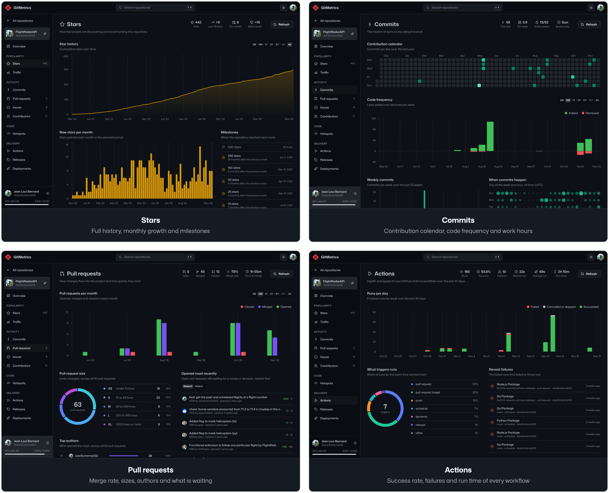
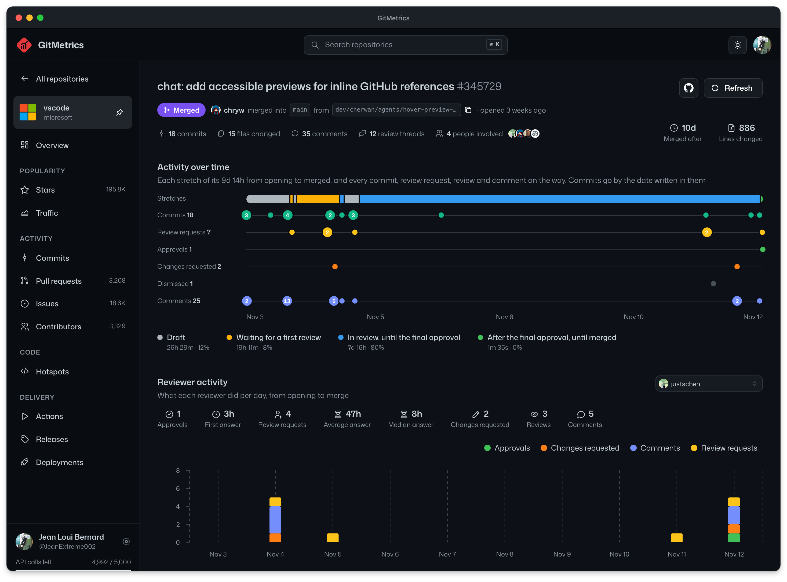
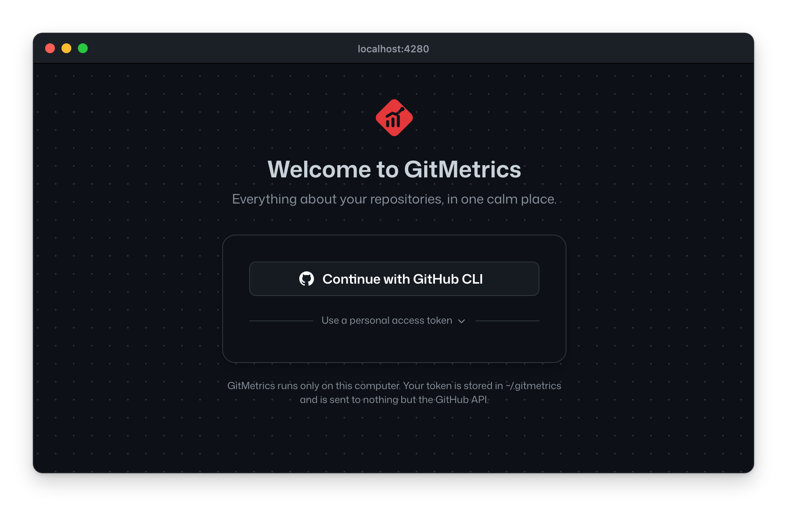

<div align="center">

<picture>
  <source media="(prefers-color-scheme: dark)" srcset="assets/logo-dark.svg" />
  
</picture>

# GitMetrics

<b>Every number behind your GitHub repositories, in one dashboard.</b><br>
<i>Stars, traffic, commits, pull requests and CI health. Running on your machine, one command away.</i>

<p align="center">
  <a href="https://github.com/JeanExtreme002/GitMetrics/actions/workflows/ci.yml"></a>
  <a href="https://codecov.io/gh/JeanExtreme002/GitMetrics"></a>
  <a href="https://www.npmjs.com/package/@gitmetrics/app"></a>
  <a href="https://nodejs.org"></a>
  <a href="#quick-start"></a>
  <a href="LICENSE"></a>
</p>


</div>

GitHub shows bits of your projects in scattered places, forgets older traffic and leaves the big picture to you. **GitMetrics fills those gaps** with one fast dashboard that sees everything and remembers it.

## Quick start

You only need [Node.js](https://nodejs.org) 20.19 or newer.

```bash
npx @gitmetrics/app
```

Your browser opens on [http://localhost:4280](http://localhost:4280). Sign in and you are done.

**Install it globally:**

```bash
npm install -g @gitmetrics/app
gitmetrics
```

## What's inside

<p align="center">
  
</p>

Each repository also gets **Overview**, **Traffic**, **Issues**, **Contributors**, **Hotspots**, **Releases** and **Deployments**, plus a home page across everything you own and <kbd>Ctrl</kbd> + <kbd>K</kbd> to jump anywhere. Light and dark themes included.

## Every pull request, and what it needs

<p align="center">
  
</p>

One list of every pull request that involves you, across all your repositories, with what each one waits on. Open one to see where its time went, every commit, review request, review and comment on the way, and how fast each reviewer answered.

## Follow how your projects grow

See where every repository is heading: stars gained, release cadence, how fast pull requests land and how healthy your CI is. Pin the projects you care about, and the home page ranks all of them by stars, activity or traffic.

## Traffic history that never expires

GitHub keeps only the last 14 days of traffic. Each time you open GitMetrics (and once a day while it stays open), it saves the traffic of all your repositories, and of any other you opened in the last year, merging it with what it saw before. Your views and clones history keeps growing, even for repositories you don't open, as long as you start GitMetrics at least every two weeks.

## Signing in

GitMetrics uses your own GitHub access, so it sees exactly what you can see.

<p align="center">
  
</p>

- **GitHub CLI:** if you use the [GitHub CLI](https://cli.github.com), one click reuses its session.
- **Personal access token:** [create one](https://github.com/settings/tokens/new?scopes=repo,read:user,read:org&description=GitMetrics) with the `repo`, `read:user` and `read:org` scopes, then paste it.

Your token is kept in `~/.gitmetrics`, readable only by you, and signing out deletes it.

> [!TIP]
> Have your own GitHub OAuth App? Set its client ID in the `GITMETRICS_CLIENT_ID` environment variable to also get a **Sign in with GitHub** button that confirms a short code in your browser.

## Privacy

No backend, no account, no analytics. GitMetrics runs only on `127.0.0.1` and talks only to `api.github.com`, plus npm to check for a newer version. Your token, pins, cache and traffic history stay in `~/.gitmetrics`, private to you. Signing out deletes the token.

## Options

```text
gitmetrics [options]

  -p, --port <number>  Port to listen on (default: 4280)
      --no-open        Do not open the browser automatically
  -v, --version        Print the version
  -h, --help           Show this message
```

**Environment variables:**

- `GITMETRICS_HOME` keeps the data somewhere other than `~/.gitmetrics`.
- `GITMETRICS_CLIENT_ID` enables **Sign in with GitHub** through your own OAuth App.
- `GITMETRICS_NO_UPDATE_CHECK=1` stops GitMetrics from checking npm for a newer version.

## Contributing

Ideas, bug reports and pull requests are very welcome. [CONTRIBUTING.md](CONTRIBUTING.md) explains how to run the project locally in a couple of minutes. If GitMetrics is useful to you, a star on the repository helps other people find it.

## License

GitMetrics is free software under the [GNU AGPL-3.0](LICENSE). Use it, change it and sell it, as long as the code stays open and the credit to the original author stays visible. The [NOTICE](NOTICE) file has the full terms.
