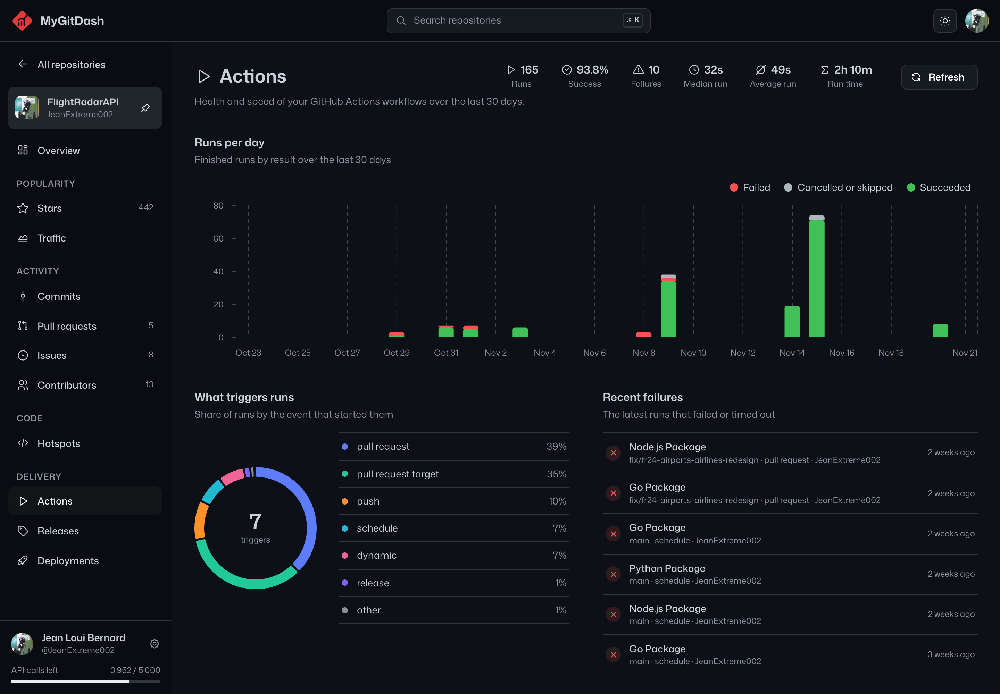

<div align="center">

<picture>
  <source media="(prefers-color-scheme: dark)" srcset="assets/logo-dark.svg" />
  
</picture>

# MyGitDash

<b>Every number behind your GitHub repositories, on one screen.</b><br>
<i>Stars, traffic, commits, pull requests and CI health. Running on your machine, one command away.</i>

<br>

[](https://github.com/JeanExtreme002/MyGitDash/actions/workflows/ci.yml)
[](https://codecov.io/gh/JeanExtreme002/MyGitDash)
[](https://www.npmjs.com/package/mygitdash)
[](https://nodejs.org)
[](#quick-start)
[](LICENSE)

<br>


</div>

<br>

GitHub spreads your project's numbers across a dozen tabs and deletes traffic after 14 days. **MyGitDash brings them together in one fast dashboard**, and keeps the history GitHub throws away.

## Quick start

You only need [Node.js](https://nodejs.org) 20.19 or newer.

```bash
npx mygitdash
```

Your browser opens on [http://localhost:4280](http://localhost:4280). Sign in and you are done.

Prefer a permanent command? Install it globally:

```bash
npm install -g mygitdash
mygitdash
```

## What's inside

<table>
  <tr>
    <td width="50%"></td>
    <td width="50%"></td>
  </tr>
  <tr>
    <td align="center"><b>Stars</b><br>Full history, monthly growth and milestones</td>
    <td align="center"><b>Commits</b><br>Contribution calendar, code frequency and work hours</td>
  </tr>
  <tr>
    <td width="50%"></td>
    <td width="50%"></td>
  </tr>
  <tr>
    <td align="center"><b>Pull requests</b><br>Merge rate, sizes, authors and what is waiting</td>
    <td align="center"><b>Actions</b><br>Success rate, failures and run time of every workflow</td>
  </tr>
</table>

Also **Overview**, **Traffic**, **Issues**, **Contributors**, **Hotspots**, **Releases** and **Deployments** for each repository, a home page across everything you own, and <kbd>⌘</kbd> <kbd>K</kbd> to jump to any repository. Light and dark themes included.

## Follow how your projects grow

See where every repository is heading: stars gained, release cadence, how fast pull requests land and how healthy your CI is. Pin the projects you care about, and the home page ranks all of them by stars, activity or traffic.

## Traffic history that never expires

GitHub keeps only the last 14 days of traffic. MyGitDash saves each window on your machine and merges it with what it saw before, so your views and clones history keeps growing for as long as you use it.

## Signing in

- **GitHub CLI:** if you use the [GitHub CLI](https://cli.github.com), one click reuses your session.
- **Personal access token:** paste a [token](https://github.com/settings/tokens/new?scopes=repo,read:user,read:org&description=MyGitDash) with the `repo`, `read:user` and `read:org` scopes.

Have your own GitHub OAuth App? Set `MYGITDASH_CLIENT_ID` to also get a **Sign in with GitHub** button that confirms a short code in your browser.

## Privacy

No backend, no account, no analytics. MyGitDash listens only on `127.0.0.1` and talks only to `api.github.com`. Your token, pins, cache and traffic history stay in `~/.mygitdash`, readable only by you. Signing out deletes the token.

## Options

```text
mygitdash [options]

  -p, --port <number>  Port to listen on (default: 4280)
      --no-open        Do not open the browser automatically
  -v, --version        Print the version
  -h, --help           Show this message
```

| Variable              | What it does                                               |
| --------------------- | ---------------------------------------------------------- |
| `MYGITDASH_HOME`      | Keeps the data somewhere other than `~/.mygitdash`         |
| `MYGITDASH_CLIENT_ID` | Enables **Sign in with GitHub** through your own OAuth App |

## Contributing

Ideas, bug reports and pull requests are welcome. [CONTRIBUTING.md](CONTRIBUTING.md) shows how to run the project locally in a couple of minutes.

## License

[MIT](LICENSE)
