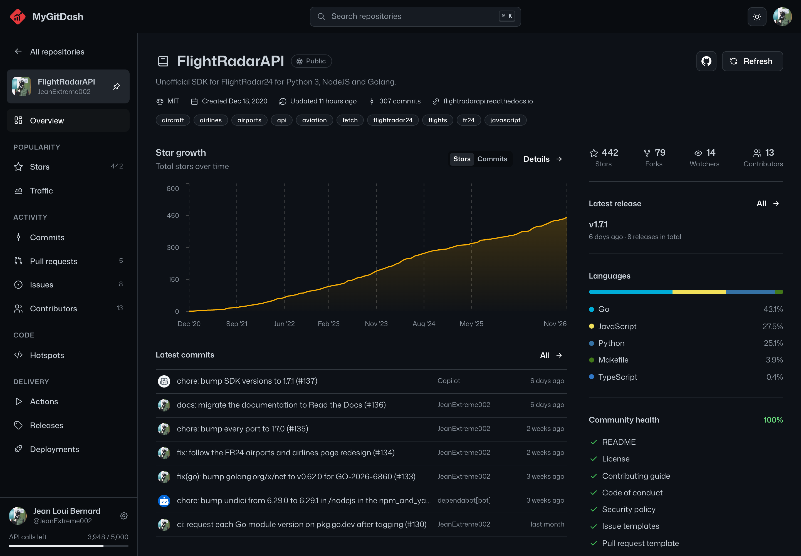
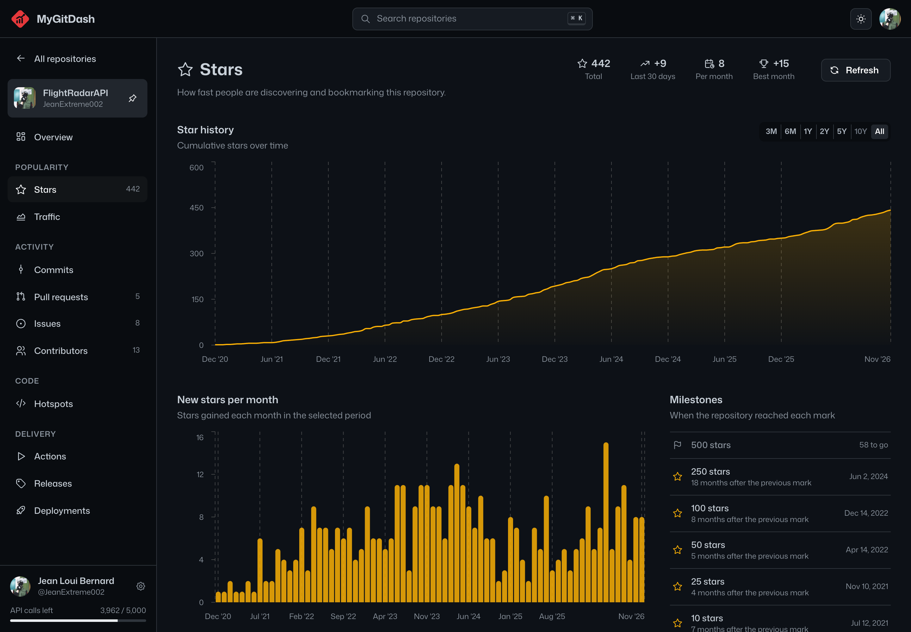
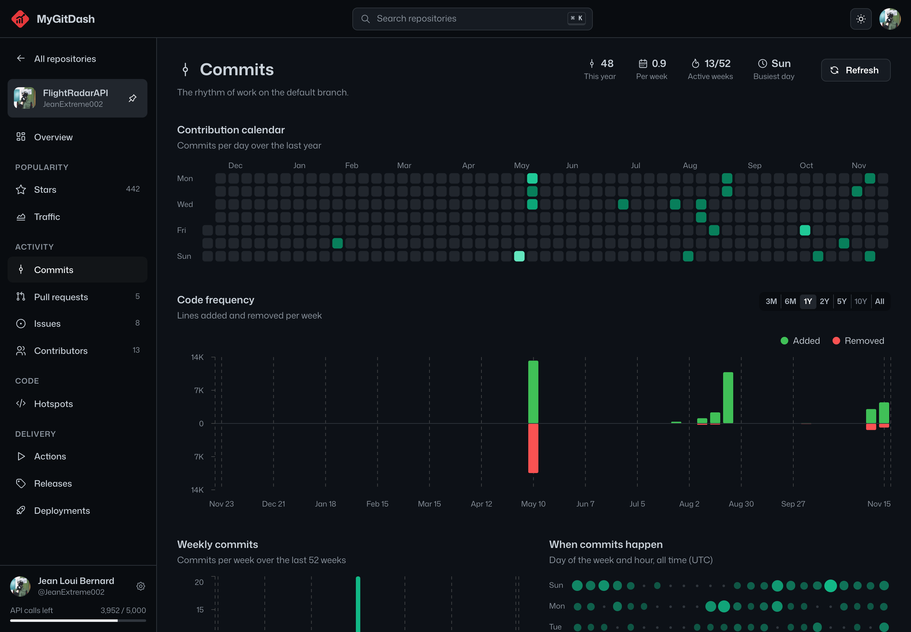
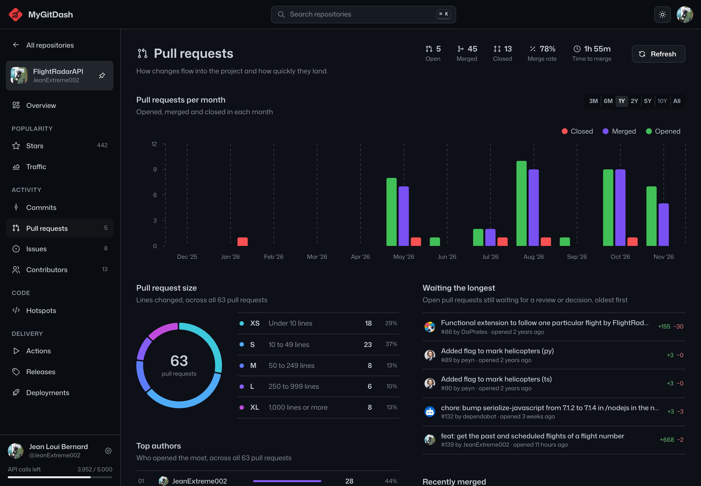

<div align="center">

<picture>
  <source media="(prefers-color-scheme: dark)" srcset="assets/logo-dark.svg" />
  
</picture>

# MyGitDash

**A beautiful dashboard for your GitHub repositories. One command, zero configuration.**

[](https://www.npmjs.com/package/mygitdash)
[](https://github.com/JeanExtreme002/MyGitDash/actions/workflows/ci.yml)
[](https://codecov.io/gh/JeanExtreme002/MyGitDash)
[](LICENSE)
[](https://github.com/JeanExtreme002/MyGitDash/stargazers)



</div>

GitHub knows a lot about your projects, but it is scattered across a dozen tabs, and some of it, like traffic, disappears after two weeks. MyGitDash gathers all of it into a calm, fast dashboard that runs on your own computer. Sign in with your GitHub account and every repository you own is ready to explore, with nothing to configure.

## Quick start

You only need [Node.js](https://nodejs.org) 20.19 or newer.

```bash
npx mygitdash
```

Your browser opens on `http://localhost:4280`. Sign in and you are done. If you prefer a permanent command, install it globally with `npm install -g mygitdash` and run `mygitdash` whenever you like.

## What you get

Each repository has its own space, split into short, focused pages so you can find an answer without wading through charts you don't need.

| Page              | What it answers                                                                                       |
| ----------------- | ----------------------------------------------------------------------------------------------------- |
| **Overview**      | The essentials at a glance: stars, forks, languages, community health and the latest release.         |
| **Stars**         | Your full star history, new stars per month, your best month and how the last 30 days went.           |
| **Traffic**       | Views, unique visitors, clones, top referrers and most visited pages.                                 |
| **Commits**       | A contribution calendar, weekly activity, code frequency and the hours your team actually works.      |
| **Pull requests** | Merge rate, median time to merge, PR sizes, top authors and the pull requests waiting the longest.    |
| **Issues**        | Opened versus closed over time, time to close, most used labels and the oldest open issues.           |
| **Contributors**  | Who builds the project, how many people were active recently, newcomers per month and the bus factor. |
| **Hotspots**      | The files and folders that change the most, shown as a treemap of your codebase.                      |
| **Actions**       | Success rate, failures, typical duration and run time for every workflow in the last 30 days.         |
| **Releases**      | Release cadence, asset downloads and a timeline of what you shipped.                                  |
| **Deployments**   | Deployments per environment, their status and how often you go live.                                  |

The home page gives you the big picture across everything you own: totals, pinned projects, a ranking of your repositories by stars, recent activity or traffic, and the languages you use. The Repositories page lists every repository you can reach, with filters by account, language and visibility, and you can jump to any of them from anywhere with <kbd>⌘</kbd> <kbd>K</kbd>. Light and dark themes are both included.

<div align="center">




</div>

## Traffic history that never expires

GitHub only keeps the last 14 days of traffic. Every time you open the Traffic page, MyGitDash saves that window on your machine and merges it with what it saw before. Open it every week or two and you build a complete, permanent history of your views and clones, something GitHub itself does not offer.

## Signing in

MyGitDash supports three ways to sign in, and the login screen only shows the ones available on your machine. **Sign in with GitHub** opens GitHub in your browser and asks you to confirm a short code, the same flow used by the GitHub CLI. If you already use the [GitHub CLI](https://cli.github.com), **Continue with GitHub CLI** reuses that session in one click. You can also paste a [personal access token](https://github.com/settings/tokens/new?scopes=repo,read:user,read:org&description=MyGitDash) with the `repo` and `read:user` scopes.

## Privacy

MyGitDash has no backend, no account and no analytics. It is a small server that listens only on `127.0.0.1` and talks to nothing but `api.github.com`. Your token, pinned repositories, cache and traffic history live in `~/.mygitdash`, readable only by your user. Signing out deletes the token.

## Options

```text
mygitdash [options]

  -p, --port <number>  Port to listen on (default: 4280)
      --no-open        Do not open the browser automatically
  -v, --version        Print the version
  -h, --help           Show this message
```

Set `MYGITDASH_HOME` to keep the data somewhere other than `~/.mygitdash`, or `MYGITDASH_CLIENT_ID` to sign in through your own GitHub OAuth App.

## Contributing

Ideas, bug reports and pull requests are very welcome. [CONTRIBUTING.md](CONTRIBUTING.md) explains how to run the project locally in a couple of minutes. If MyGitDash is useful to you, a star on the repository helps other people find it.

## License

MyGitDash is released under the [MIT License](LICENSE).
